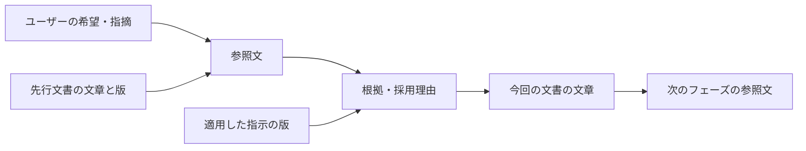
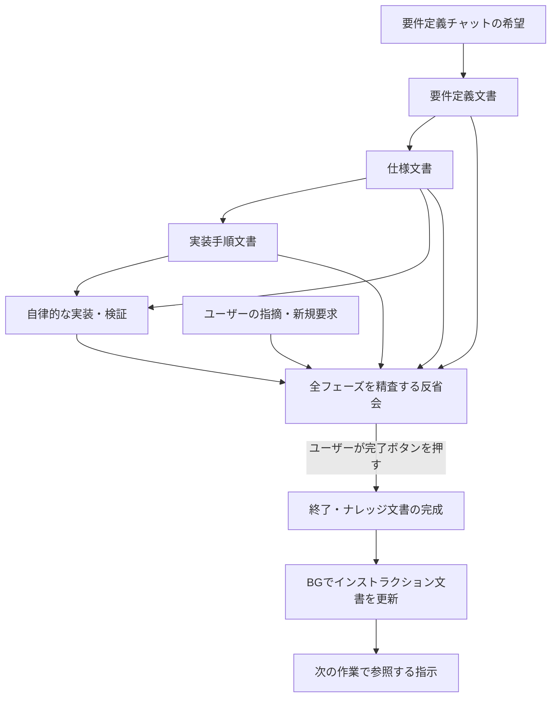

# 要求・根拠を追跡できる文書管理

全フェーズの文書を、参照文・インストラクション・採用理由で繋ぐための実装設計。要件定義、仕様整理、実装手順、反省会、ナレッジ、インストラクションに共通の文書テーブルを使う。実装作業と反省会の精査はLLMが自律的に進め、ナレッジ完成後にインストラクションをバックグラウンドで更新する。

この文書は動作と保存方式を記載する。現行実装と差がある箇所は未実装の設計として明記する。保存先の概要は [データ設計](data/README.md#正本と表示用データ)、フェーズの動作は [全体仕様](specification.md) を参照する。

## 文書を繋ぐ単位

どの文書も「参照文を集める → 適用するインストラクションを踏まえて根拠を示す → 文書の文章を書く」を繰り返して作る。ユーザーの追加要求や訂正も参照文として取り込み、関連する項目を更新する。準備フェーズの遷移はユーザーが行い、仕様整理・実装手順へ遷移すると先行文書を読むところから文書作成を開始する。

| 要素 | 内容 |
| --- | --- |
| 参照文 | ユーザーの要求・フィードバック、先行する文書から抽出した原文、判断材料となる調査・検証結果。元の発言または文書項目と、その版を持つ。 |
| 適用したインストラクション | 文書作成時に実際に渡した共通・フェーズ別指示の版。採用理由に影響した条項も参照できるようにする。 |
| 根拠・採用理由 | 参照文と指示から、なぜこの内容を書くのかを説明する。LLMが要求をどう解釈し、何を満たすための表現としたかを記録する。 |
| ドキュメントテキスト | 根拠に基づいて書いた段落や箇条書きなどの文章。文書項目を順番に連結したものが最終Markdownとなる。 |

参照文と根拠の対応は多対多とする。一つの根拠が複数の要求や先行文書の文章を参照でき、一つの原文を複数の根拠で使える。根拠とドキュメントテキストは、項目の各版において一対一とする。

参照文には原文の引用と参照先を保存し、引用が指定した版の本文と一致することをバックエンドで検証する。引用範囲は原文の位置情報とともに保持する。抽出した文章の要約や解釈は根拠欄に記録する。要件定義で要求を整理するときも、整理した文章から最初のユーザー発言へ戻れるようにする。

文章を辿ると分岐や合流があるため、複数の親を参照できる構造にする。参照先は確定した過去の版に固定する。インストラクションの更新によって過去の文書が参照していた指示の版を書き換えず、次の作業から新しい指示の版を使う。

## 全フェーズの流れ

### 要件定義

ユーザーがチャットに希望を書く。LLMはその発言と適用中のインストラクションを読み、書く内容の根拠を示し、要件定義の文書項目を作る。追加の会話ごとに、参照文・根拠・文章を追加または更新する。モデルの解釈とユーザーが確認した内容は、本文や根拠の記述で区別する。

### 仕様整理

遷移時に完成した要件定義文書を読み、仕様へ具体化するための参照文を抽出する。その原文を根拠の材料として置き、共通・仕様整理のインストラクションを加味して採用理由を作り、仕様文書の文章を書く。ユーザーのフィードバックも同じ参照文として取り込み、文書を更新する。

`documents.md` の索引、追加する仕様文書、調査資料を共通の文書モデルで管理する。先行文書のどの文章を具体化したかを項目単位で保持する。

### 実装手順

完成した仕様文書を読み、作業順序や検証方法の根拠となる原文を抽出する。参照文と適用中の指示から書く内容を決め、実装手順の文章にする。フィードバックへの対応も、参照文・根拠・文章の組で記録する。

準備フェーズで先行文書が更新された場合は、参照している項目を再確認し、新しい版を採用するかを記録する。古い版への参照も履歴として保持する。

### 実装

仕様文書、実装手順、インストラクションを読み、合意した作業と検証がすべて終わるまで自律的に進める。開始時に参照した文書と指示の版を記録する。コーディングや検証の結果は、既存の会話・ツール実行履歴に保存し、関連する仕様項目・手順項目から辿れるようにする。

未達・中断・実行不能はその状態と原因を記録する。通常の実装完了後は反省会へ進み、全体の精査を自動で開始する。実装が失敗や結果不明で終わった場合も、その事実を反省会の精査対象に含める。

### 反省会

遷移後、LLMがこれまでの全フェーズの要求、参照文、根拠、文書、フィードバック、実装・検証結果を精査する。フォローアップが必要になった箇所について、発見した原文を引用し、要因の根拠と「どうすればよかったか」を文書項目にする。観測できた事実、原因の仮説、改善策を区別して記録する。

全体の精査が完了するまで自律的に継続する。精査完了後はユーザーの指摘や新規要求をチャットで受け、反省会の文書へ同じ形式で追加する。指摘への手直し・検証と、その結果も記録する。ユーザーが満足して「タスク完了」を押すと終了へ移る。

### 終了

反省会の文書から原文を抽出し、終了用インストラクションと既存ナレッジを踏まえて根拠を示し、ナレッジ文書の項目を作成・更新する。ナレッジも文書テーブルを正本とし、`knowledge.md` を生成する。

`finish_knowledge` は最新のナレッジ版と理由を記録する。新しい知識の追加が不要な場合も既存の版と理由を指定する。終了の完了判定にはこの記録が必要となる。確認した反省会の版を完了記録へ個別に紐づける設計は未実装。終了画面では進捗と履歴を閲覧できる。

ナレッジ完成時にタスクを完了とし、その版を入力にするインストラクション更新ジョブを登録する。インストラクション更新はBGで進め、タスクの完了状態とジョブの状態を別々に持つ。

### BGでのインストラクション更新

完成したナレッジ文書から参照文を抽出し、最新のインストラクションと照合して、変更する内容の根拠を作る。共通・各フェーズの該当する文書項目を自動更新する。更新ごとのユーザー確認は設けず、採用理由と変更履歴を保存する。

プロジェクト固有の知識は適用範囲を保持する。全プロジェクトへ適用するインストラクションには、確認した学びから共通化できる行動ルールを反映する。既存の指示と重複する場合は、その項目へ根拠を追加・統合できる。新しい指示が不要な場合は、確認した内容と理由を記録してジョブを完了する。

## 反省会の全件精査

反省会の開始時に、対象のフェーズ・会話範囲・文書版・項目版・実行結果を一覧として固定する。最終版に加えて、途中の要求変更、撤回された判断、フォローアップのきっかけとなる過去の版を含める。当時使ったインストラクションも版を固定して確認する。

精査対象ごとに読み進めた位置と所見を保存する。末尾まで取得した資料に所見を記録できる。バックエンドは正常終了時に所見が未記録の件数を検査し、残りがなければ精査完了とする。参照元が欠落している場合は確認不能の所見を記録する。取得処理そのものに失敗した場合は精査を再試行できる。

`review_next` で未精査資料を順に取得する。長い資料は分割して読み、継続位置と所見を保存する。通常の会話に渡す抜粋とは別の経路を使う。現行の精査リストは初回の開始時に固定する。追加指摘や手直しに応じて影響する項目を再精査に加え、所見と反省会の項目版を紐づける設計は未実装。

初期精査中は進捗と履歴を表示し、終了後にユーザーとの会話へ移る。通常の精査が完了するまで「タスク完了」は有効にしない。停止や取得失敗が起きた場合は保存済みの進捗から再開できるようにする。実装の未達事項の扱いはユーザーとの反省会で決め、その判断を文書に残す。

## 保存モデルと版

プロジェクト側の `.beni/project.sqlite` に文書管理用テーブルを追加する。アプリ全体のインストラクション文書とBGジョブはアプリ側のSQLiteに保存する。両方に同じ文書項目・参照文・根拠のモデルを適用する。

| データ | 保存する内容 |
| --- | --- |
| 文書と版 | 所属スコープ、文書名、版ID、生成本文のハッシュ、更新者を表す識別子、更新時刻。現在版の参照を別に保存する。 |
| 文書項目 | 各文書版に順序付きの項目を保存する。項目は ID、Markdown 本文、根拠・採用理由、原文参照を持つ。過去の項目を指定するときは文書版と項目IDを組み合わせる。 |
| 参照文 | 参照元の種類・ID、文書の場合は版、引用開始位置と原文。発言はフェーズ・会話ID・発言ID、ツール出力はフェーズ・会話ID・パックIDで識別する。 |
| 送信時の文脈 | タスクと送信ID、フェーズ、適用した共通・フェーズ指示の版、参照したタスク文書版、送信時に組み立てた指示本文。 |
| 精査の進捗 | 対象タスク、固定した資料一覧、資料ごとの継続位置と所見。 |
| BGジョブ | 入力のタスク・ナレッジ・完了回の版、状態、再試行情報、更新元と更新後の指示の版、失敗理由。 |

LLMの解釈は、各項目の根拠として、その時点で説明できる採用理由を記録する。過不足と改善策は反省会の文書項目に保存する。根拠の材料を読み直せるよう、既存の [プロジェクトイベント](project-events/README.md) と [会話履歴](data/beni/chat.md) に接続する。

項目IDは修正や並べ替えでも維持し、本文・根拠・参照や項目の順序を変えた結果は新しい文書版に保存する。独立した項目版ID・種類・確認状態、分割・統合の元項目との対応、参照文の役割を個別に保持する設計は未実装。見出し、項目名、一覧の各項目を含め、非空の項目を追加・変更するときは根拠と原文参照を必須にする。空行と空白は文書の区切りとして扱う。初期項目と取り込んだ文書には、テンプレートや移行元の情報を保存する。

ナレッジとインストラクションも同じ構造を持つため、指示の文章から反省会、実装手順、仕様、要件、ユーザーの原文まで逆に辿れる。各段階で、生成に影響した当時の指示の版も確認できる。

ユーザーが見出しの不足を指摘した場合は、その発言を引用して見出しを追加する。反省会では不足と修正結果を記録し、終了時に再利用できる構成上の学びをナレッジへまとめる。共通化できる学びはBG更新で指示に反映し、指示から発端の指摘まで辿れるようにする。

参照文の引用は根拠の記録として保持する。元の会話を削除した場合も文書版に引用が残る。参照元の欠落をプレビューで示す機能は未実装。タスクを削除した後もイベント API から過去の本文を取得できる。プロジェクトを移動した場合は元のプロジェクトIDとの対応を維持する。

## 更新とMarkdown生成

LLMは専用ツールで文書と参照文を扱う。取得結果にはIDと版を含め、ページの続きを指定できる。ユーザーの編集依頼もチャットから同じ経路を通す。

| ツール | 契約 |
| --- | --- |
| `list_documents`、`read_document` | 文書名・版を一覧し、指定版の項目本文と根拠への参照を分割取得する。実装中は開始時の文書版が既定となる。 |
| `list_chat_sources`、`read_source` | 同じタスク内の発言・実行結果を一覧し、指定した参照の原文を分割取得する。 |
| `edit_document` | 編集元の版、更新ID、挿入・変更・移動・削除を渡す。本文に採用理由と原文引用を添え、更新後の版と項目IDを返す。 |
| `review_next`、`record_review` | 未精査の資料を取得する。末尾まで取得した資料について、確認結果を保存する。 |
| `finish_execution`、`finish_knowledge`、`finish_instruction_update` | 実装結果、完成したナレッジ版、または指示の更新結果を、理由付きで確定する。 |

1. 対象の文書版、更新ID、追加・変更・並べ替え・削除する項目を送る。バックエンドで所属・フェーズ・更新可能な文書を検証し、参照文の原文一致を確認する。参照元の文章は判断材料として扱う。
2. 編集元の版を照合し、項目・参照・根拠・文書版・変更履歴を同じDBトランザクションで保存する。同じ更新IDと内容の再送は確定済みの結果を返す。競合時は最新の版を読み、根拠を確認して更新を作り直す。
3. 画面に表示するときやLLMへ渡すときに、文書版の項目テキストを順番に連結する。改行と空行も項目に含めるため、同じ版から同じMarkdownを組み立てられる。タスク文書とナレッジはDB内で完結し、リポジトリの納品物として必要な仕様書は実装時に対象版からファイルへ出力する。

旧Markdownは初回参照時にスコープ単位で取り込む。版の保存と移行済みの記録を同じトランザクションで確定し、途中で失敗した場合は同じ原本から再試行する。移行後の読み書きはDBへ統一し、既存ファイルは保全する。旧ファイルの変更履歴は保持し、DB文書の変更も同じ履歴で参照できる。

## BGジョブの確実な起動と更新

ナレッジの確定版と理由をプロジェクト側DBに記録する。その記録を基に、タスクを完了にする前にアプリ側DBの永続キューへ更新依頼を登録する。終了チャットの会話IDを依頼IDとし、終了処理の再開時にも同じIDで照合する。変更不要で同じナレッジ版を使った場合も、完了回を識別する。

ジョブは待機・実行中を表す処理待ち、成功、失敗、後続依頼で置換済みの状態を持つ。アプリ再起動時は、結果が確定していないジョブの保存状態と指示の版を照合して再開する。入力のナレッジ版を固定し、複数プロジェクトの更新をアプリ側で直列化する。指示の更新とジョブ成功は同じDBトランザクションで確定する。

タスクを再開して再度完了した場合は、新しい完了回からジョブを作る。同じタスクの前のジョブが待機中なら後続依頼で置換済みにする。実行中の場合も保存直前に後続依頼の有無を確認し、置換済みの依頼からの更新を拒否する。処理済みの指示に対する訂正は新しい指示の版として記録し、新旧の学びを履歴上で対応づける。

ジョブで扱える更新先はインストラクションに限定し、知識の参照範囲と更新権限をバックエンドで与える。失敗時はタスクの完了と指示更新の失敗をそれぞれ表示し、同じ依頼IDで再試行できるようにする。

## 文書と精査の画面

生成した文書はMarkdownプレビューで閲覧できる。要件定義・仕様整理・実装手順・反省会の対話はチャットから行い、実装中・反省会の自動精査中・終了中は進捗と履歴を表示する。

インストラクション画面では共通・フェーズ別の指示と編集相談用の本文を閲覧する。バックグラウンドの指示更新は専用ジョブで行い、タスクの終了画面で状態を表示する。

タスク文書とインストラクションのプレビューでは、根拠付きの文章にカーソルを合わせるか、キーボードでフォーカスするとポップアップを表示する。保存した根拠と参照元の引用を、表示中の文書版から取得する。本文と項目の範囲を対応づけ、通常のMarkdown表示から確認できるようにする。

文書取得時には根拠付き項目のIDと本文上の範囲を返す。ポップアップを開いたときに、文書名・版・項目IDで `GET /api/document-provenance` を呼び、根拠と引用を取得する。タスク文書の場合はプロジェクトIDとタスクIDも指定する。

## 確認条件

| 実装単位 | 確認条件 |
| --- | --- |
| 共通文書モデルと移行 | 全種類の文書で参照文・根拠・文章を保存でき、同じ版から同じMarkdownを生成できる。複数の親、引用範囲、移動・分割・統合後の参照を維持する。 |
| 準備フェーズの文書生成 | 先行文書と指示の版から文章を作り、ユーザーのフィードバックも取り込める。各文章から元の要求と指示を逆に辿れる。 |
| 実装と反省会 | 実装結果と文書項目を関連づけ、全フェーズを分割取得して精査完了まで進められる。中断、欠落、追加指摘を確認状態に反映する。 |
| 終了とBG更新 | ナレッジ完成から指示更新が自動起動する。再起動・再試行・複数タスクの完了でも依頼が消失・重複せず、指示の競合を検出できる。 |
| 文書表示 | 全文書と指示の生成本文を閲覧でき、実行中・失敗・完了の状態を確認できる。 |

既存Markdownは区切りも含めて項目へ取り込み、再生成結果が元の本文と一致することを確認する。過去の根拠を確認できない項目は未整理とし、原文を確認できたものから参照を付ける。既存インストラクションも導入時点の版として取り込む。

確認範囲は、要件定義からインストラクションの自動更新までを繋いだ一連の流れとする。現行データの移行・競合・再開の検証は、実サービスへ接続せず既存の模擬エージェントを使って行う。
